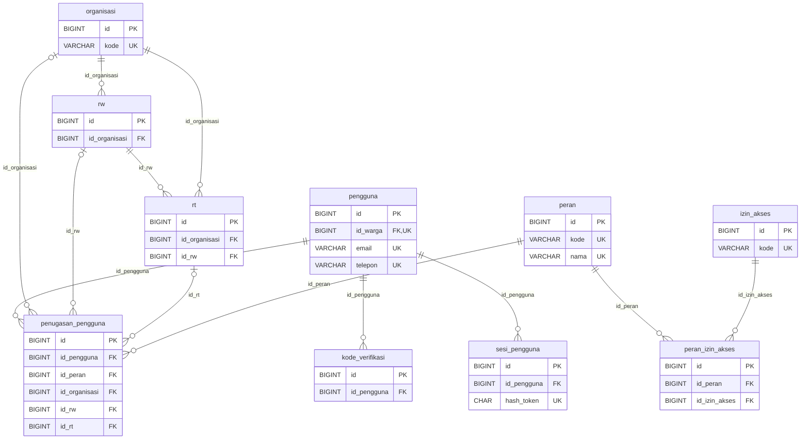
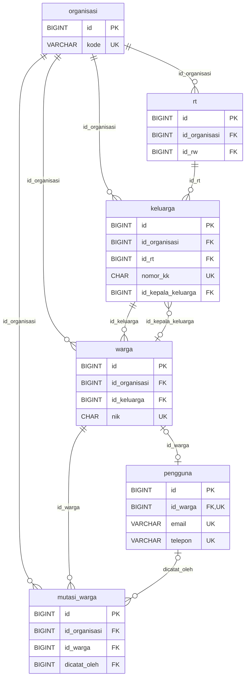
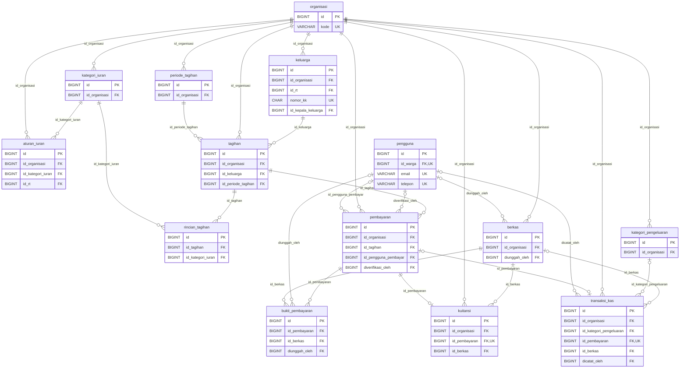
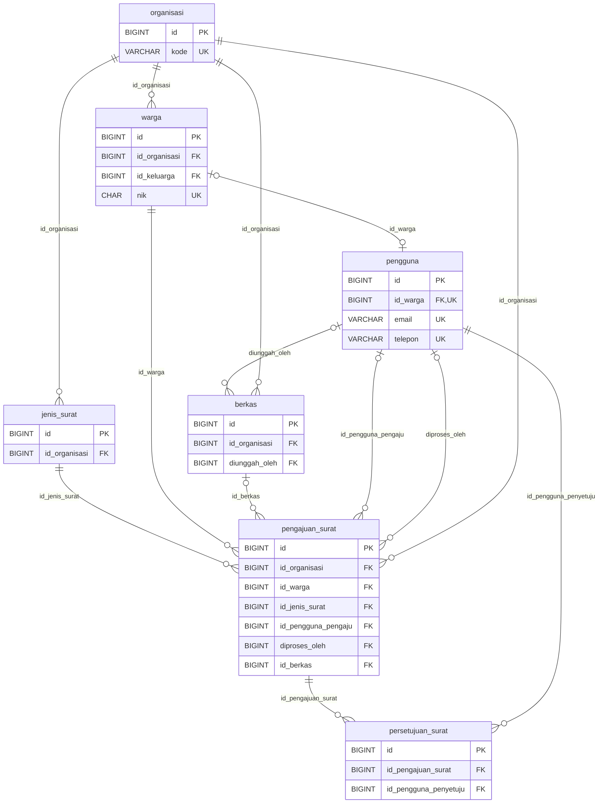
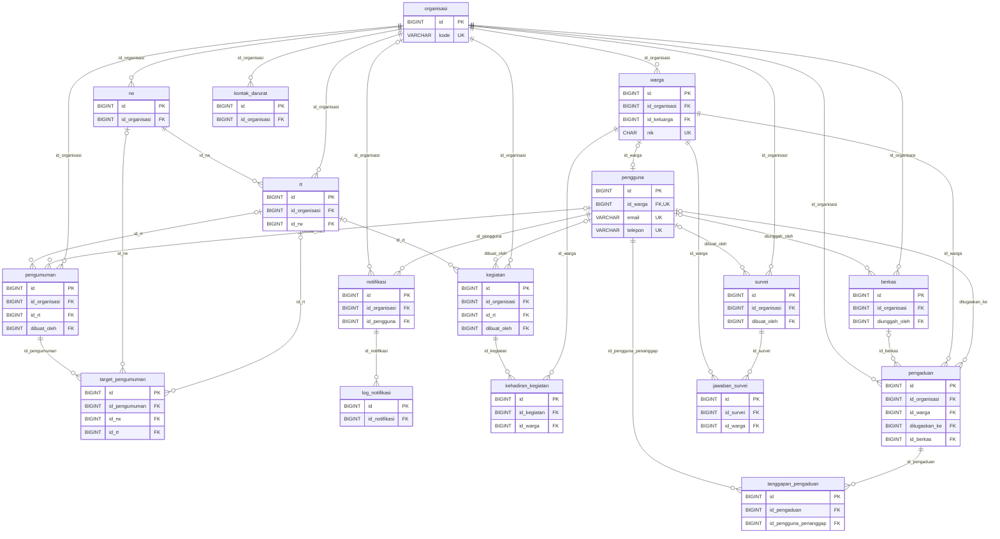
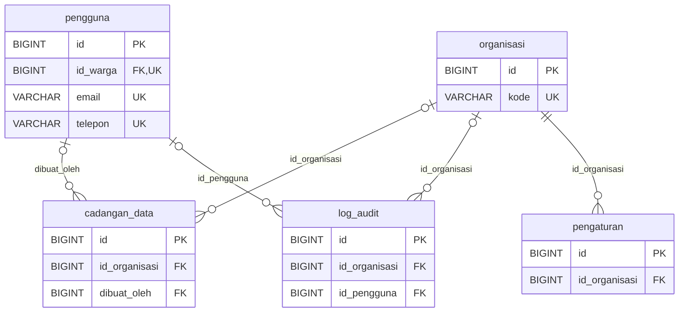

# ERD — Sistem Informasi RT/RW

> Dihasilkan otomatis dari `database/schema.sql` (41 tabel). Diagram di bawah memakai **Mermaid**, jadi tampil langsung di GitHub.
> Hanya kolom kunci (PK = primary key, FK = foreign key, UK = unique) yang ditampilkan agar diagram tetap terbaca. Daftar kolom lengkap ada di [kamus-data.md](kamus-data.md).

**Cara membaca:** `||--o{` artinya satu induk memiliki nol atau banyak anak. `||--o|` artinya satu induk memiliki nol atau satu anak. Simbol `|o` di sisi induk = relasi opsional (kolom FK boleh NULL, anak tidak wajib punya induk). `UK` pada diagram = kolom unik tunggal; kolom yang menjadi bagian dari unique gabungan (mis. `id_organisasi + nomor_rw`) tidak diberi tanda.

**Isolasi multi-RT/RW:** hampir semua tabel operasional memiliki `id_organisasi` (lihat catatan di bagian bawah halaman ini).

## Wilayah, akun, dan hak akses

## Data warga dan keluarga

## Keuangan

## Surat

## Informasi, kegiatan, pengaduan, dan survei

## Sistem dan keamanan

## Catatan desain

1. **Relasi melingkar `keluarga` ↔ `warga`.** `warga.id_keluarga` menunjuk keluarga, dan `keluarga.id_kepala_keluarga` menunjuk warga. Saat mengisi data, buat keluarga dulu (kepala kosong), lalu warga, lalu isi `id_kepala_keluarga`.
2. **Akun terhubung ke warga lewat `pengguna.id_warga`** (UNIQUE, boleh NULL untuk Super Admin).
3. **Peran dan wilayah ada di `penugasan_pengguna`.** Satu pengguna dapat memiliki beberapa penugasan (peran + organisasi/RW/RT).
4. **Hak akses berbasis peran.** `peran` → `peran_izin_akses` → `izin_akses`. Kolom `terbatas = 1` berarti izin bertanda `*` di matriks (hanya data milik sendiri / wilayahnya).
5. **Alur uang:** `tagihan` → `pembayaran` → (`bukti_pembayaran`, `kuitansi`, `transaksi_kas`). Satu tagihan boleh memiliki banyak pembayaran (cicilan).
6. **Berkas** disimpan sebagai metadata di tabel `berkas`; file aslinya berada di penyimpanan privat di luar database.
7. **`id_organisasi`** ada di tabel yang di-query langsung. Tabel anak (`rincian_tagihan`, `bukti_pembayaran`, `persetujuan_surat`, `target_pengumuman`, `kehadiran_kegiatan`, `tanggapan_pengaduan`, `jawaban_survei`, `log_notifikasi`, `peran_izin_akses`) mengikuti organisasi tabel induknya.
