# Flowchart Sistem Informasi RT/RW

Dokumen ini memuat alur kerja (flowchart) sistem, mulai dari **alur utama**, **alur tiap modul**, sampai **alur tiap fitur**. Diagram memakai **Mermaid**, jadi tampil langsung di GitHub. Alurnya mengikuti desain di folder `01-desain-modul-menu` dan `02-desain-fitur`, serta tabel pada ERD.

**Cara membaca:** oval = mulai atau selesai, kotak = proses, belah ketupat = keputusan. Peran (Warga, Admin, Bendahara, dan lainnya) ditulis di dalam kotak proses.

## Daftar Isi

1. [Alur Utama Sistem](#1-alur-utama-sistem)
2. [Dashboard & Laporan](#2-dashboard--laporan)
3. [Manajemen Data Warga](#3-manajemen-data-warga)
4. [Keuangan RT/RW](#4-keuangan-rtrw)
5. [Administrasi Surat](#5-administrasi-surat)
6. [Layanan Warga](#6-layanan-warga)
7. [Informasi & Komunikasi](#7-informasi--komunikasi)
8. [Sosial & Kegiatan](#8-sosial--kegiatan)
9. [Keamanan & Lingkungan](#9-keamanan--lingkungan)
10. [Registrasi & Akses](#10-registrasi--akses)
11. [Keamanan Akun](#11-keamanan-akun)
12. [Manajemen Platform](#12-manajemen-platform)
13. [Catatan](#13-catatan)

---

## 1. Alur Utama Sistem

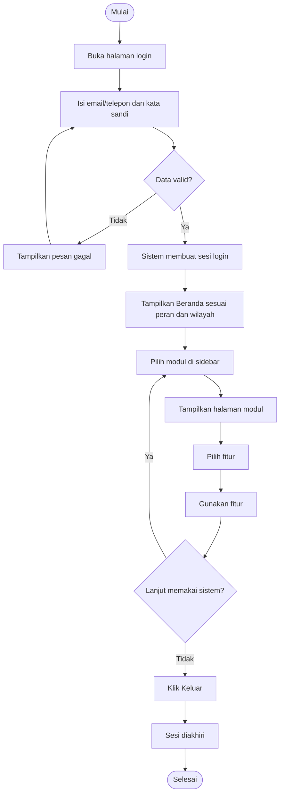

---

## 2. Dashboard & Laporan

**Alur modul**

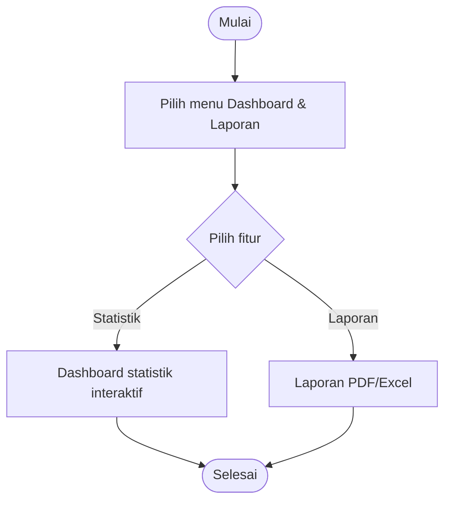

### 2.1 Dashboard statistik interaktif

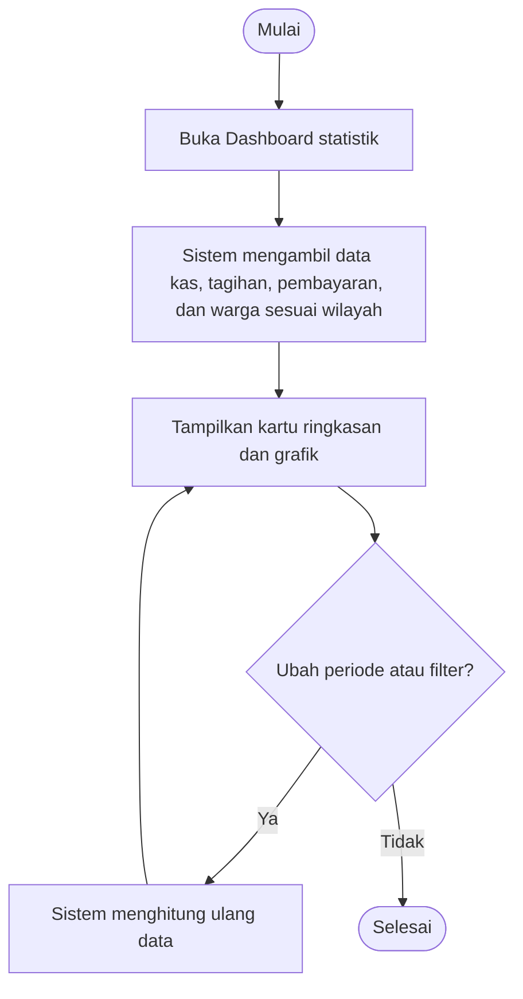

### 2.2 Laporan PDF/Excel

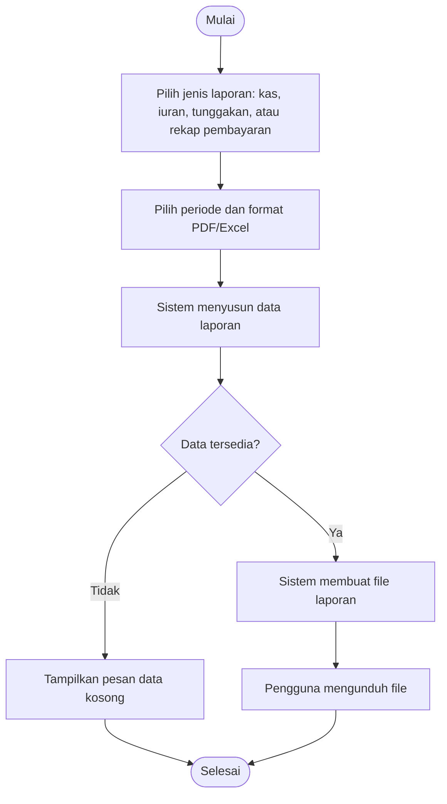

---

## 3. Manajemen Data Warga

**Alur modul**

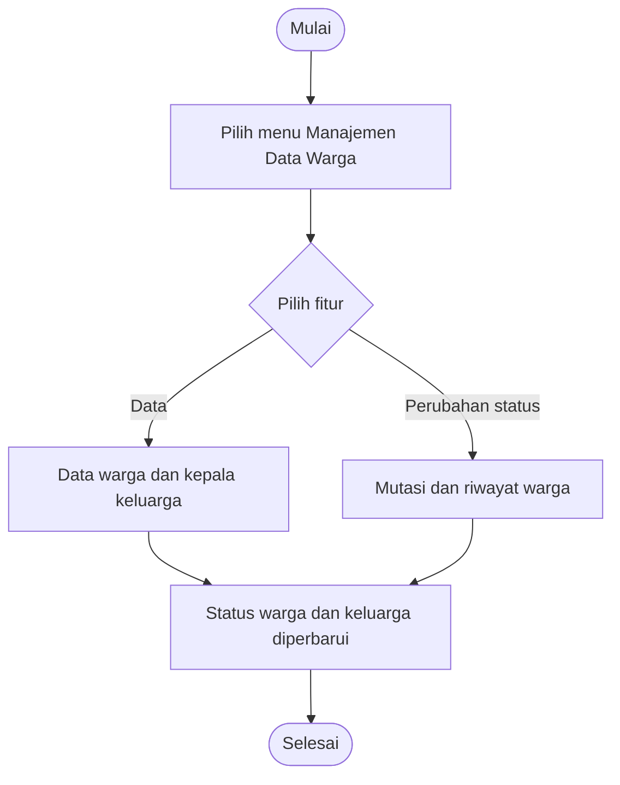

### 3.1 Data warga & kepala keluarga

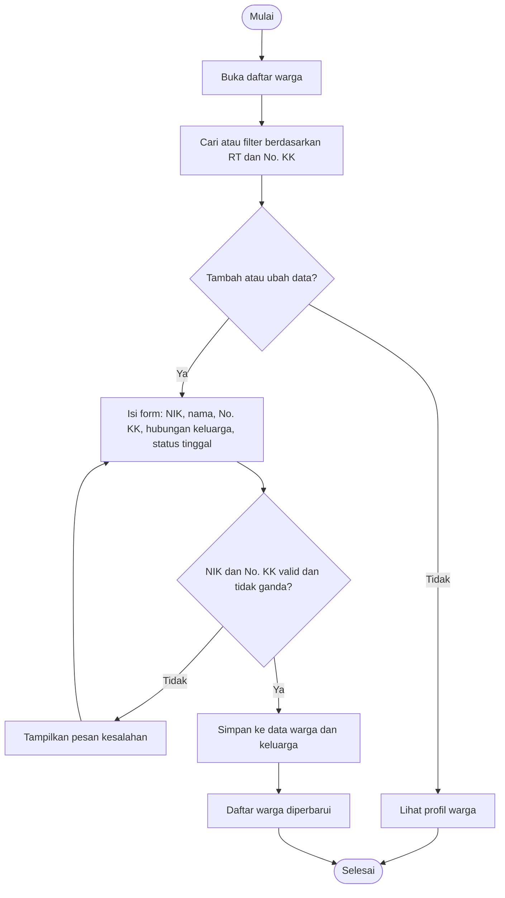

### 3.2 Mutasi dan riwayat warga

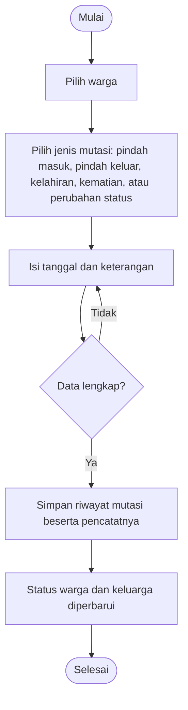

---

## 4. Keuangan RT/RW

**Alur modul** (urutan umum dari aturan iuran sampai kas)

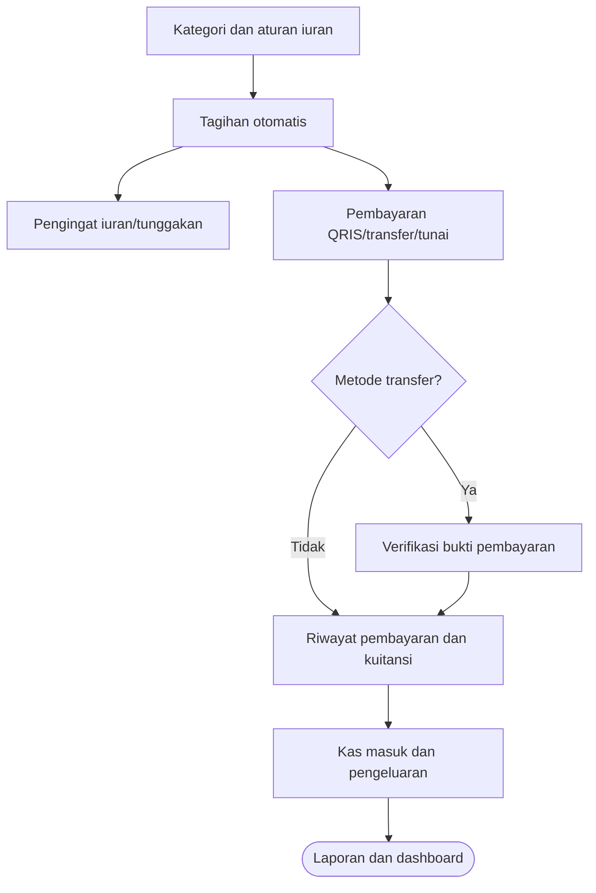

### 4.1 Kategori dan aturan iuran

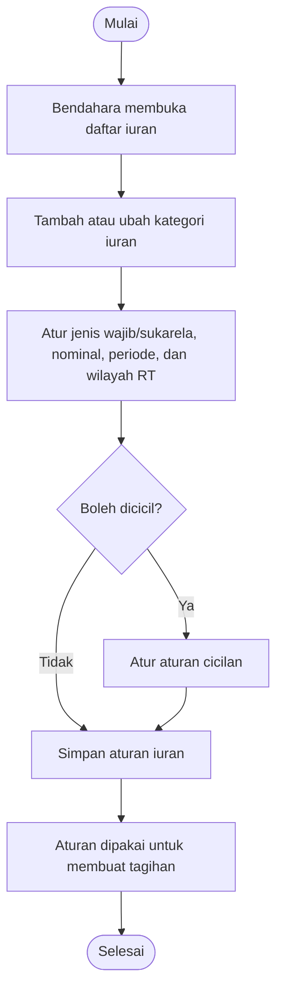

### 4.2 Tagihan otomatis

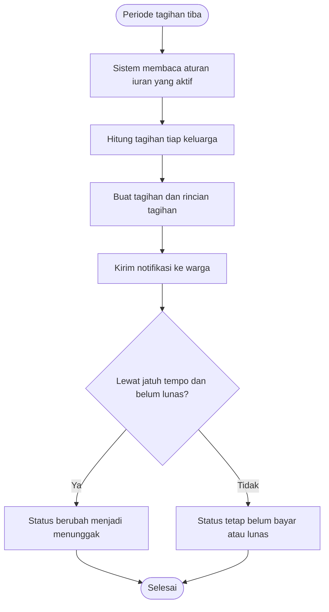

### 4.3 Pembayaran QRIS/transfer/tunai

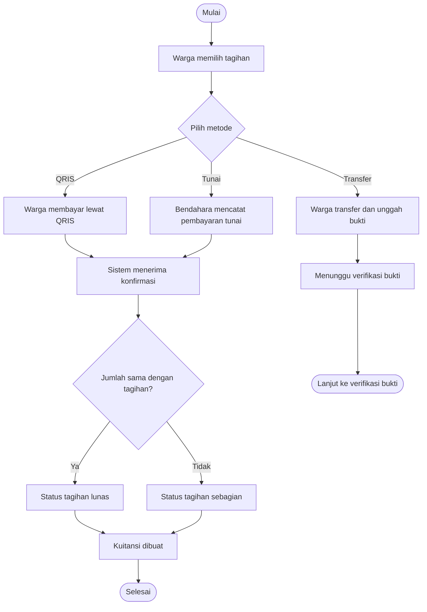

### 4.4 Verifikasi bukti pembayaran

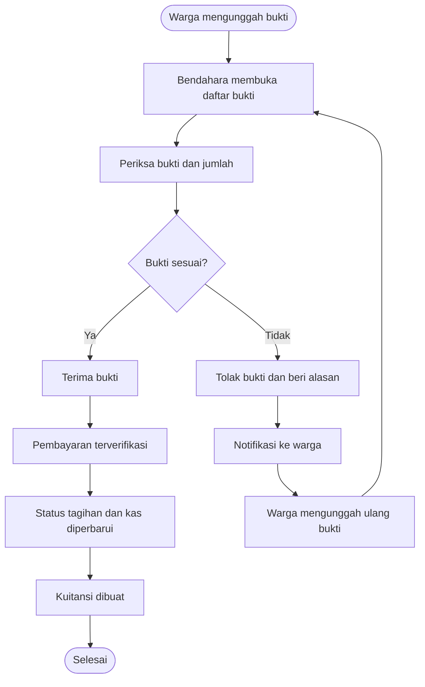

### 4.5 Riwayat pembayaran & kuitansi

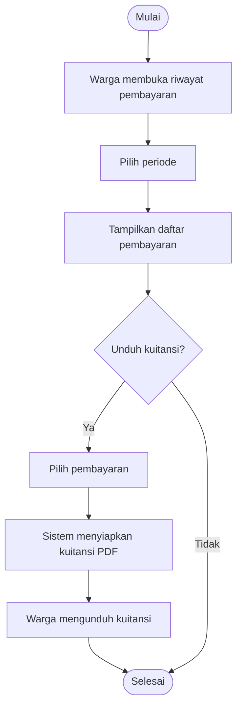

### 4.6 Kas masuk dan pengeluaran

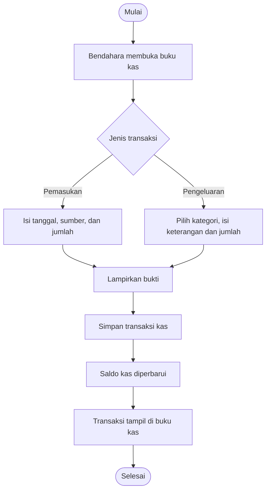

### 4.7 Pengingat iuran/tunggakan

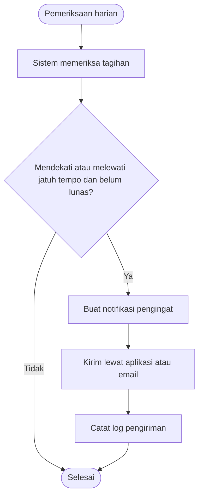

---

## 5. Administrasi Surat

**Alur modul**

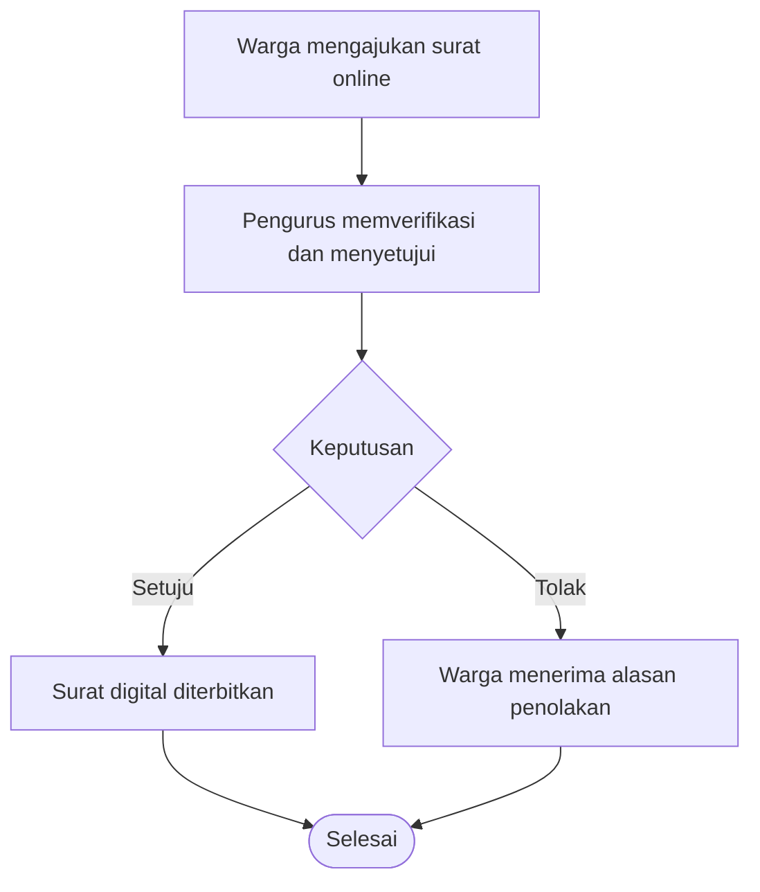

### 5.1 Pengajuan surat online

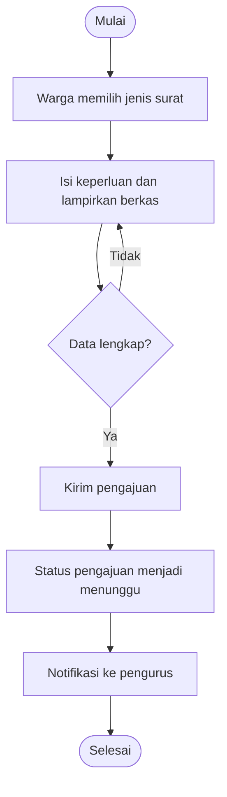

### 5.2 Verifikasi dan persetujuan surat

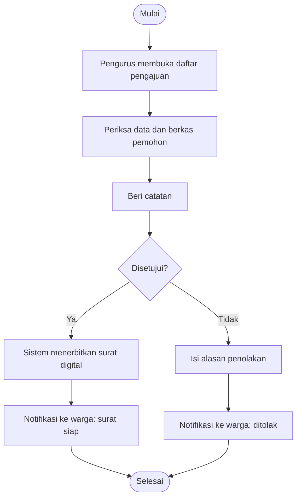

---

## 6. Layanan Warga

**Alur modul**

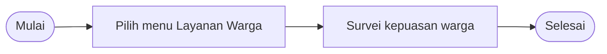

### 6.1 Survei kepuasan warga

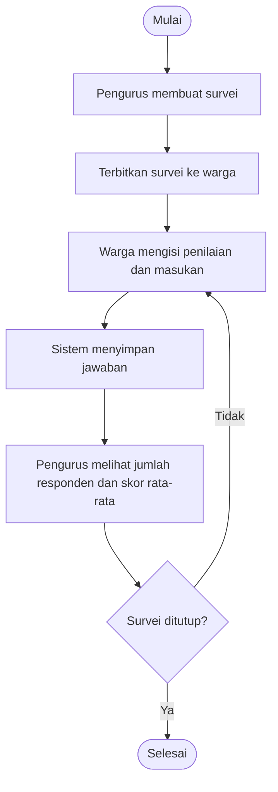

---

## 7. Informasi & Komunikasi

**Alur modul**

```mermaid
flowchart TD
  A["Pengurus menerbitkan pengumuman"] --> B["Sistem membuat notifikasi"]
  B --> C["Warga menerima notifikasi"]
  C --> D["Warga membaca pengumuman"]
  D --> E(["Selesai"])
```

### 7.1 Pengumuman RT/RW

```mermaid
flowchart TD
  A(["Mulai"]) --> B["Pengurus menulis judul dan isi pengumuman"]
  B --> C["Pilih target: semua warga, RW, atau RT tertentu"]
  C --> D{"Kirim sekarang?"}
  D -->|Ya| E["Terbitkan pengumuman"]
  D -->|Tidak| F["Jadwalkan waktu terbit"]
  F --> E
  E --> G["Simpan pengumuman dan target"]
  G --> H["Notifikasi dikirim ke warga target"]
  H --> I(["Selesai"])
```

### 7.2 Notifikasi aplikasi

```mermaid
flowchart TD
  A(["Peristiwa terjadi: tagihan, pembayaran, surat, pengumuman, atau kegiatan"]) --> B["Sistem membuat notifikasi untuk pengguna terkait"]
  B --> C["Kirim notifikasi"]
  C --> D["Catat log pengiriman"]
  D --> E["Pengguna membuka notifikasi"]
  E --> F["Notifikasi ditandai sudah dibaca"]
  F --> G(["Selesai"])
```

---

## 8. Sosial & Kegiatan

**Alur modul**

```mermaid
flowchart LR
  A(["Mulai"]) --> B["Pilih menu Sosial & Kegiatan"] --> C["Jadwal kegiatan/kerja bakti"] --> D(["Selesai"])
```

### 8.1 Jadwal kegiatan/kerja bakti

```mermaid
flowchart TD
  A(["Mulai"]) --> B["Pengurus membuat kegiatan: nama, tanggal, tempat, RT"]
  B --> C["Simpan kegiatan"]
  C --> D["Publikasikan dan kirim notifikasi ke warga"]
  D --> E["Warga melihat jadwal"]
  E --> F{"Hari kegiatan tiba?"}
  F -->|Tidak| E
  F -->|Ya| G["Pengurus mencatat kehadiran warga"]
  G --> H["Status kegiatan menjadi selesai"]
  H --> I(["Selesai"])
```

---

## 9. Keamanan & Lingkungan

**Alur modul**

```mermaid
flowchart TD
  A(["Mulai"]) --> B["Pilih menu Keamanan & Lingkungan"]
  B --> C{"Pilih fitur"}
  C -->|Ada kejadian| D["Laporan keluhan/kejadian"]
  C -->|Butuh nomor penting| E["Kontak darurat/direktori layanan"]
  D --> F(["Selesai"])
  E --> F
```

### 9.1 Laporan keluhan/kejadian

```mermaid
flowchart TD
  A(["Mulai"]) --> B["Warga membuat laporan: jenis, isi, dan foto"]
  B --> C["Kirim laporan"]
  C --> D["Pengurus menugaskan petugas"]
  D --> E["Petugas menindaklanjuti dan memberi tanggapan"]
  E --> F{"Masalah selesai?"}
  F -->|Tidak| E
  F -->|Ya| G["Status laporan menjadi selesai"]
  G --> H["Notifikasi ke pelapor"]
  H --> I(["Selesai"])
```

### 9.2 Kontak darurat/direktori layanan

```mermaid
flowchart TD
  A(["Mulai"]) --> B["Buka direktori layanan"]
  B --> C["Cari atau filter kategori kontak"]
  C --> D["Pilih kontak"]
  D --> E["Tampilkan nama layanan dan nomor telepon"]
  E --> F{"Pengurus ingin mengubah data?"}
  F -->|Ya| G["Tambah atau ubah kontak"]
  G --> H["Simpan kontak"]
  H --> I(["Selesai"])
  F -->|Tidak| I
```

---

## 10. Registrasi & Akses

**Alur modul** (dari pendaftaran sampai hak akses)

```mermaid
flowchart TD
  A["Registrasi warga"] --> B["Verifikasi akun oleh Admin"]
  B --> C["Manajemen peran dan hak akses"]
  C --> D(["Akun siap dipakai login"])
```

### 10.1 Registrasi warga

```mermaid
flowchart TD
  A(["Mulai"]) --> B["Warga mengisi nama, HP/email, dan kata sandi"]
  B --> C{"Data valid dan belum terdaftar?"}
  C -->|Tidak| D["Tampilkan pesan kesalahan"]
  D --> B
  C -->|Ya| E["Sistem membuat akun dan mengirim kode OTP"]
  E --> F["Warga memasukkan kode OTP"]
  F --> G{"Kode benar?"}
  G -->|Tidak| H["Kirim ulang kode"]
  H --> F
  G -->|Ya| I["Akun menunggu verifikasi Admin"]
  I --> J(["Selesai"])
```

### 10.2 Verifikasi akun oleh Admin

```mermaid
flowchart TD
  A(["Mulai"]) --> B["Admin membuka daftar pendaftar"]
  B --> C["Periksa data pendaftar"]
  C --> D{"Data warga ditemukan?"}
  D -->|Ya| E["Tautkan akun ke warga, keluarga, dan wilayah"]
  E --> F["Setujui akun"]
  F --> G["Akun aktif dan notifikasi dikirim"]
  D -->|Tidak| H["Tolak pendaftaran dengan alasan"]
  H --> I["Notifikasi ke pendaftar"]
  G --> J(["Selesai"])
  I --> J
```

### 10.3 Manajemen peran dan hak akses

```mermaid
flowchart TD
  A(["Mulai"]) --> B["Admin memilih pengguna"]
  B --> C["Pilih peran: Super Admin, Admin Perumahan, Ketua RT/RW, Bendahara, Pengurus, atau Warga"]
  C --> D["Tentukan wilayah: organisasi, RW, atau RT"]
  D --> E["Atur izin akses peran"]
  E --> F["Simpan penugasan"]
  F --> G["Izin berlaku pada login berikutnya"]
  G --> H(["Selesai"])
```

---

## 11. Keamanan Akun

**Alur modul**

```mermaid
flowchart TD
  A(["Mulai"]) --> B["Pilih menu Keamanan Akun"]
  B --> C{"Pilih fitur"}
  C -->|Jejak aktivitas| D["Riwayat aktivitas/audit log"]
  C -->|Perangkat login| E["Manajemen sesi/perangkat"]
  D --> F(["Selesai"])
  E --> F
```

### 11.1 Riwayat aktivitas/audit log

```mermaid
flowchart TD
  A(["Aktivitas penting terjadi: ubah data, login, verifikasi, persetujuan"]) --> B["Sistem mencatat waktu, pengguna, aksi, objek, dan alamat IP"]
  B --> C["Admin membuka riwayat aktivitas"]
  C --> D["Filter berdasarkan pengguna, aksi, atau tanggal"]
  D --> E{"Perlu ekspor log?"}
  E -->|Ya| F["Unduh log"]
  F --> G(["Selesai"])
  E -->|Tidak| G
```

### 11.2 Manajemen sesi/perangkat

```mermaid
flowchart TD
  A(["Mulai"]) --> B["Pengguna membuka daftar sesi aktif"]
  B --> C{"Ada perangkat tidak dikenal?"}
  C -->|Tidak| D(["Selesai"])
  C -->|Ya| E["Pilih Keluar dari perangkat lain"]
  E --> F["Konfirmasi tindakan"]
  F --> G["Sesi perangkat lain dicabut"]
  G --> H["Catat ke audit log"]
  H --> D
```

**Pembatasan percobaan login**

```mermaid
flowchart TD
  A(["Pengguna mencoba login"]) --> B{"Kata sandi benar?"}
  B -->|Ya| C["Buat sesi login"]
  B -->|Tidak| D["Tambah hitungan percobaan gagal"]
  D --> E{"Melebihi batas percobaan?"}
  E -->|Tidak| A
  E -->|Ya| F["Blokir login sementara"]
  F --> G["Catat ke audit log"]
  C --> H(["Selesai"])
  G --> H
```

---

## 12. Manajemen Platform

**Alur modul**

```mermaid
flowchart TD
  A(["Mulai"]) --> B["Pilih menu Manajemen Platform"]
  B --> C{"Pilih fitur"}
  C -->|Kelola lingkungan| D["Multi-RT/RW"]
  C -->|Cadangan data| E["Ekspor dan backup data"]
  D --> F(["Selesai"])
  E --> F
```

### 12.1 Multi-RT/RW

```mermaid
flowchart TD
  A(["Mulai"]) --> B["Super Admin menambah organisasi baru"]
  B --> C["Buat RW dan RT di dalam organisasi"]
  C --> D["Tetapkan Admin untuk organisasi"]
  D --> E["Data organisasi dipisahkan dengan id_organisasi"]
  E --> F["Admin hanya melihat data wilayahnya"]
  F --> G(["Selesai"])
```

### 12.2 Ekspor dan backup data

```mermaid
flowchart TD
  A(["Mulai"]) --> B{"Pilih tindakan"}
  B -->|Backup| C["Jadwal otomatis atau klik Backup sekarang"]
  C --> D["Sistem mengumpulkan data dan membuat cadangan"]
  D --> E{"Berhasil?"}
  E -->|Ya| F["Simpan cadangan dan catat riwayatnya"]
  E -->|Tidak| G["Tampilkan pesan gagal dan notifikasi ke admin"]
  B -->|Ekspor| H["Pilih data sesuai kewenangan"]
  H --> I["Unduh file ekspor"]
  B -->|Pemulihan| J["Pilih cadangan dan konfirmasi"]
  J --> K["Sistem memulihkan data"]
  F --> L(["Selesai"])
  G --> L
  I --> L
  K --> L
```

---

## 13. Catatan

1. **Status:** flowchart ini adalah **draft alur** yang disusun dari daftar modul dan fitur, desain tampilan, dan ERD. Detail aturan bisnis bisa disesuaikan dengan kesepakatan kelompok.
2. **Peran:** alur menuliskan peran yang paling umum melakukan langkah tersebut. Hak akses sebenarnya mengikuti matriks pada fitur *Manajemen peran dan hak akses*.
3. **Cakupan:** 1 alur utama, 11 alur modul, dan 26 alur fitur. Ditambah satu alur pembatasan percobaan login pada fitur manajemen sesi.
4. **Hubungan antarfitur:** pada alur modul Keuangan dan Registrasi & Akses, urutan panah menunjukkan keterkaitan fitur satu sama lain.
5. **Acuan:** bila ERD atau daftar fitur berubah, alur di dokumen ini perlu diperbarui.
