# Dokumentasi UI/UX: Sistem Informasi RT/RW

Folder ini berisi rancangan antarmuka (UI/UX) **Sistem Informasi RT/RW** milik kelompok kami. Rancangan masih berupa **draft desain** dan bukan frontend final. Isi tampilan mengikuti ERD (41 tabel) serta daftar modul dan fitur yang sudah disepakati.

**Cakupan:** desain **login, beranda, 11 modul (menu)**, dan **26 fitur** di dalam modul. Semuanya tersedia dalam **mode terang dan gelap** (total 78 gambar).

## Daftar Isi

1. [Tujuan Perancangan](#1-tujuan-perancangan)
2. [Tools yang Digunakan](#2-tools-yang-digunakan)
3. [Struktur Folder](#3-struktur-folder)
4. [Bagian A: Login, Beranda, dan Menu Modul](#4-bagian-a-login-beranda-dan-menu-modul)
5. [Bagian B: Tampilan Fitur di Dalam Menu](#5-bagian-b-tampilan-fitur-di-dalam-menu)
6. [Catatan](#6-catatan)

---

## 1. Tujuan Perancangan

1. Memberi gambaran alur aplikasi secara utuh: **login**, **beranda**, **menu modul**, sampai **fitur** di dalam tiap modul.
2. Menjadi acuan bersama anggota kelompok sebelum frontend dikerjakan, supaya tata letak, warna, dan istilah seragam.
3. Memastikan setiap tampilan **sejalan dengan ERD**: kolom dan data yang tampil berasal dari tabel basis data yang sudah dirancang.
4. Menguji ide dan menampung revisi lebih awal, karena mengubah gambar desain lebih murah daripada mengubah kode.
5. Menyediakan **mode terang dan mode gelap** agar nyaman dipakai di berbagai kondisi.

---

## 2. Tools yang Digunakan

| Kebutuhan | Tools |
|---|---|
| Perancangan awal dan prototipe | Claude (Anthropic), untuk menurunkan modul, fitur, dan ERD menjadi layar desain |
| Prototipe tampilan | HTML, CSS, dan JavaScript (tanpa framework) |
| Font | Plus Jakarta Sans (Google Fonts) |
| Pengambilan gambar | Screenshot halaman prototipe pada layar desktop |
| Acuan | `erd.md` (diagram Mermaid dari `database/schema.sql`) dan tabel modul serta fitur |
| Dokumentasi | GitHub (Markdown) |

> Tambahkan tools lain bila kelompok memakainya, misalnya Figma atau Canva.

**Gaya visual**

- Warna utama hijau pinus dengan aksen kuning, supaya terasa seperti lingkungan perumahan.
- Tata letak: sidebar menu di kiri dan area konten di kanan.
- Status memakai warna: hijau (selesai), kuning (menunggu), merah (ditolak atau menunggak).
- Tombol **Terang/Gelap** di pojok untuk berganti tema.

---

## 3. Struktur Folder

```
UI-UX/
├── README.md
├── 01-desain-modul-menu/          (26 gambar: login, beranda, 11 modul)
│   ├── 01-login-gelap.png
│   ├── 02-login-terang.png
│   └── ... 26-manajemen-platform-gelap.png
└── 02-desain-fitur/               (52 gambar: 26 fitur x 2 mode)
    ├── 01-dashboard-laporan/
    ├── 02-manajemen-data-warga/
    ├── 03-keuangan-rtrw/
    ├── 04-administrasi-surat/
    ├── 05-layanan-warga/
    ├── 06-informasi-komunikasi/
    ├── 07-sosial-kegiatan/
    ├── 08-keamanan-lingkungan/
    ├── 09-registrasi-akses/
    ├── 10-keamanan-akun/
    └── 11-manajemen-platform/
```

Nama file diawali nomor urut dan diakhiri `terang` atau `gelap`.

---

## 4. Bagian A: Login, Beranda, dan Menu Modul

### 4.1 Halaman Login

| Mode terang | Mode gelap |
|---|---|
| 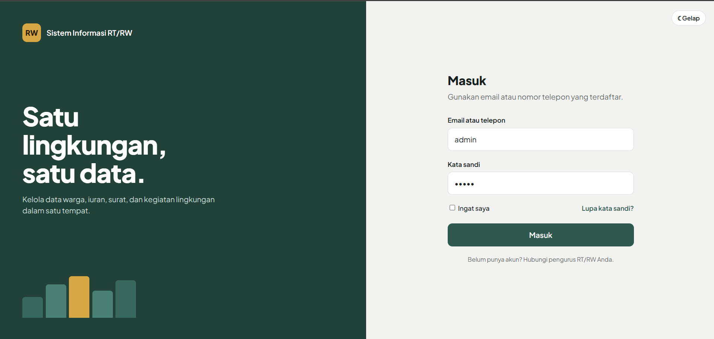 | 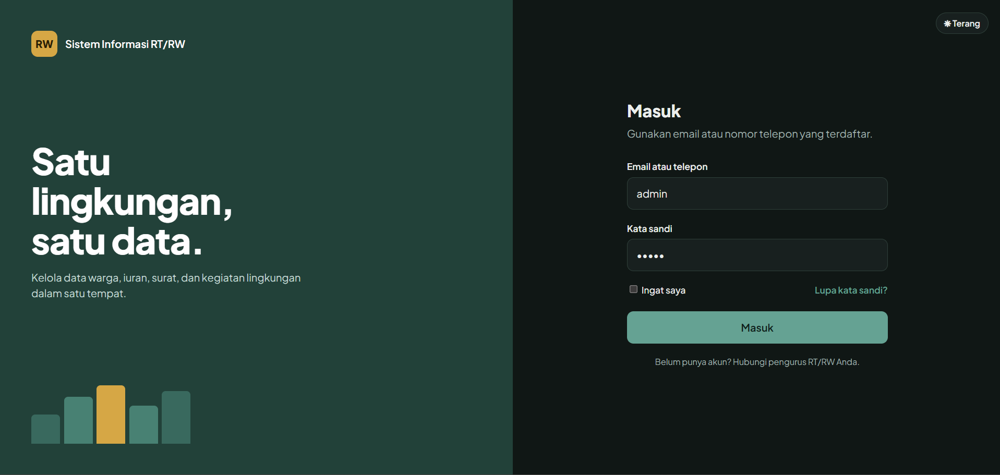 |

**Penjelasan:** Halaman pertama yang dilihat pengguna. Panel kiri berisi identitas aplikasi dan slogan, sedangkan panel kanan berisi form masuk dengan kolom **email atau telepon** dan **kata sandi**, pilihan *Ingat saya*, serta tautan *Lupa kata sandi*. Tombol di pojok kanan atas dipakai untuk berganti tema. Pendaftaran akun baru dirancang sebagai fitur *Registrasi warga* (lihat Bagian B.9).
**Tabel ERD terkait:** `pengguna`, `sesi_pengguna`

### 4.2 Beranda

| Mode terang | Mode gelap |
|---|---|
| 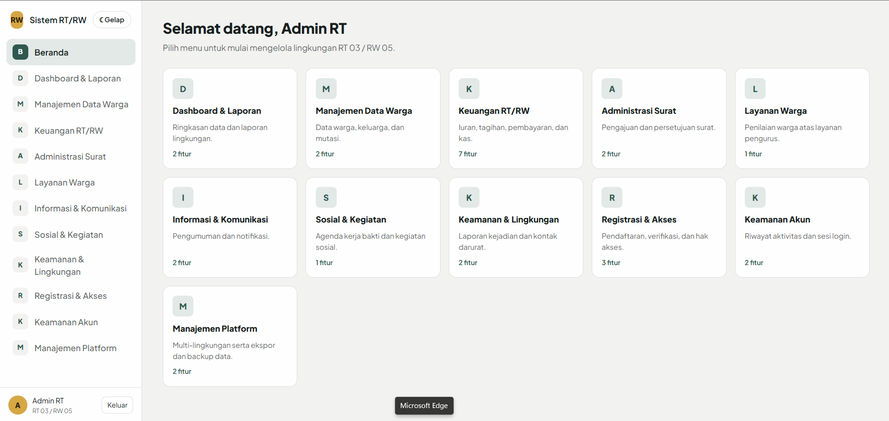 | 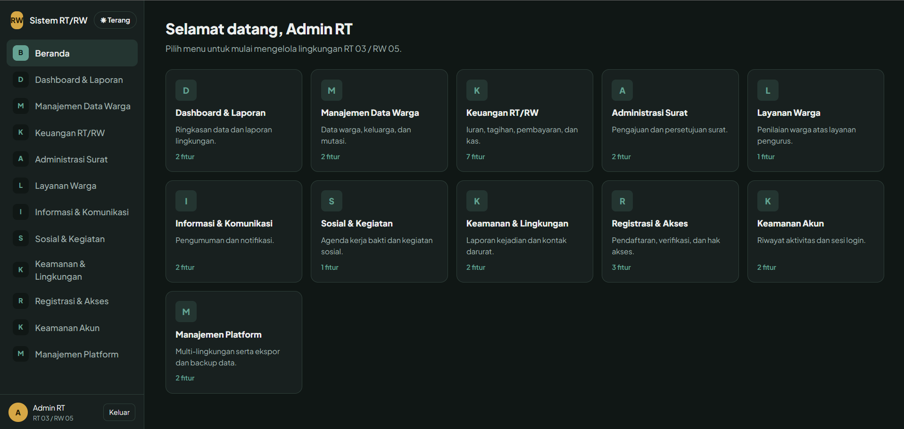 |

**Penjelasan:** Halaman utama setelah login. Sidebar di kiri memuat **11 modul** sebagai menu navigasi, ditambah menu *Beranda*. Area utama menampilkan kartu tiap modul lengkap dengan deskripsi singkat dan jumlah fiturnya. Bagian bawah sidebar menampilkan pengguna yang sedang login, wilayahnya (contoh: RT 03 / RW 05), dan tombol *Keluar*.
**Tabel ERD terkait:** `pengguna`, `penugasan_pengguna`, `peran`, `rt`, `rw`

### 4.3 Halaman Modul (Menu)

Setiap modul punya halaman sendiri. Menu yang aktif ditandai pada sidebar, dan area utama menampilkan **kartu fitur** milik modul tersebut. Tiap kartu menuju tampilan fitur pada Bagian B.

#### 4.3.1 Dashboard & Laporan

| Mode terang | Mode gelap |
|---|---|
| 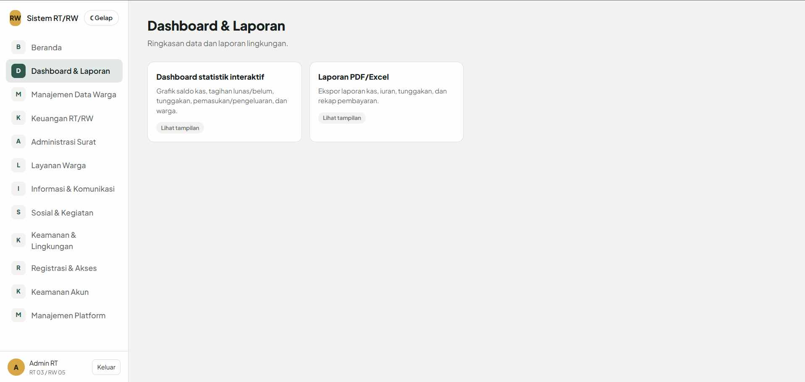 | 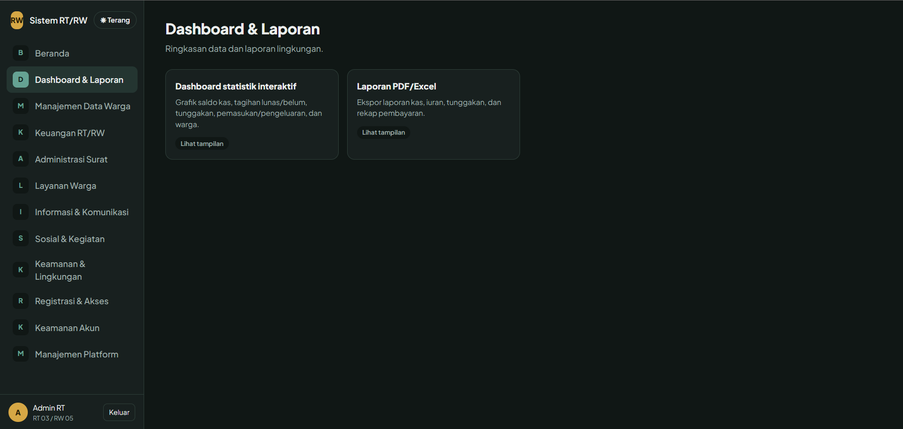 |

**Penjelasan:** Ringkasan data dan laporan lingkungan. Modul ini memuat 2 fitur: Dashboard statistik interaktif; Laporan PDF/Excel.
**Tabel ERD terkait:** `transaksi_kas`, `tagihan`, `pembayaran`, `warga`

#### 4.3.2 Manajemen Data Warga

| Mode terang | Mode gelap |
|---|---|
| 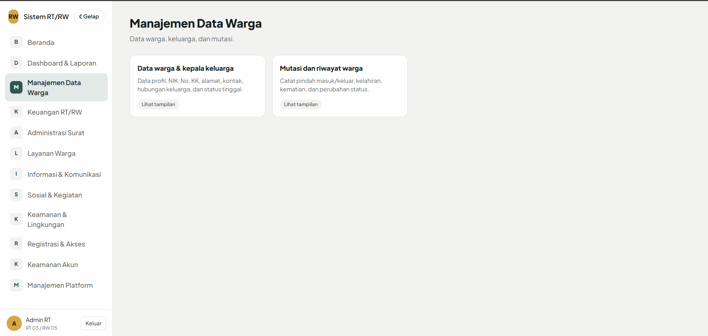 | 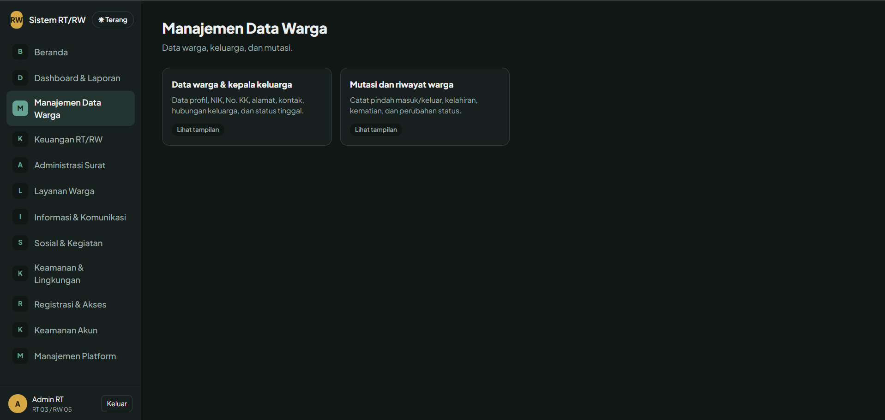 |

**Penjelasan:** Data warga, keluarga, dan mutasi. Modul ini memuat 2 fitur: Data warga & kepala keluarga; Mutasi dan riwayat warga.
**Tabel ERD terkait:** `warga`, `keluarga`, `mutasi_warga`

#### 4.3.3 Keuangan RT/RW

| Mode terang | Mode gelap |
|---|---|
| 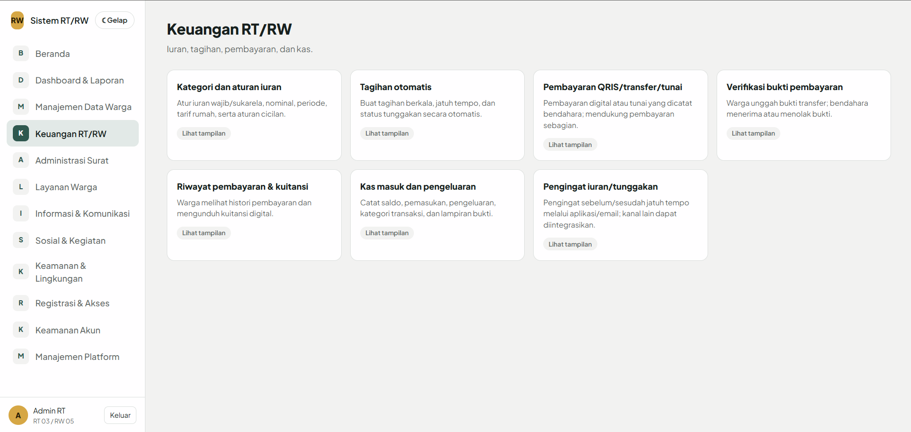 | 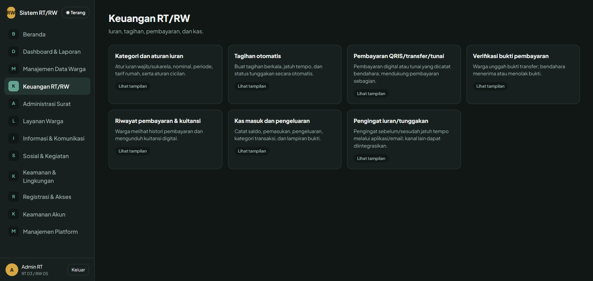 |

**Penjelasan:** Iuran, tagihan, pembayaran, dan kas. Modul ini memuat 7 fitur: Kategori dan aturan iuran; Tagihan otomatis; Pembayaran QRIS/transfer/tunai; Verifikasi bukti pembayaran; Riwayat pembayaran & kuitansi; Kas masuk dan pengeluaran; Pengingat iuran/tunggakan.
**Tabel ERD terkait:** `kategori_iuran`, `aturan_iuran`, `tagihan`, `pembayaran`, `bukti_pembayaran`, `kuitansi`, `transaksi_kas`

#### 4.3.4 Administrasi Surat

| Mode terang | Mode gelap |
|---|---|
| 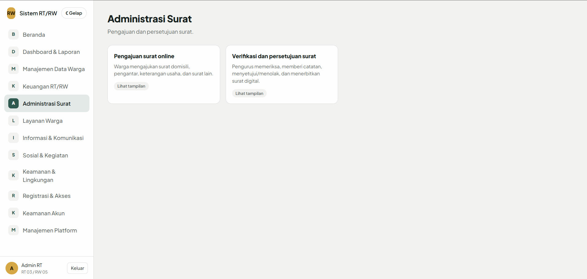 | 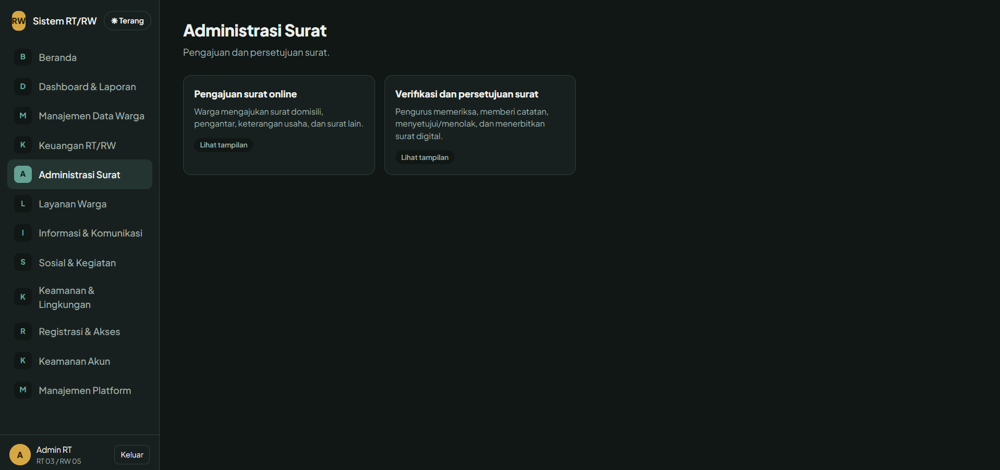 |

**Penjelasan:** Pengajuan dan persetujuan surat. Modul ini memuat 2 fitur: Pengajuan surat online; Verifikasi dan persetujuan surat.
**Tabel ERD terkait:** `jenis_surat`, `pengajuan_surat`, `persetujuan_surat`

#### 4.3.5 Layanan Warga

| Mode terang | Mode gelap |
|---|---|
| 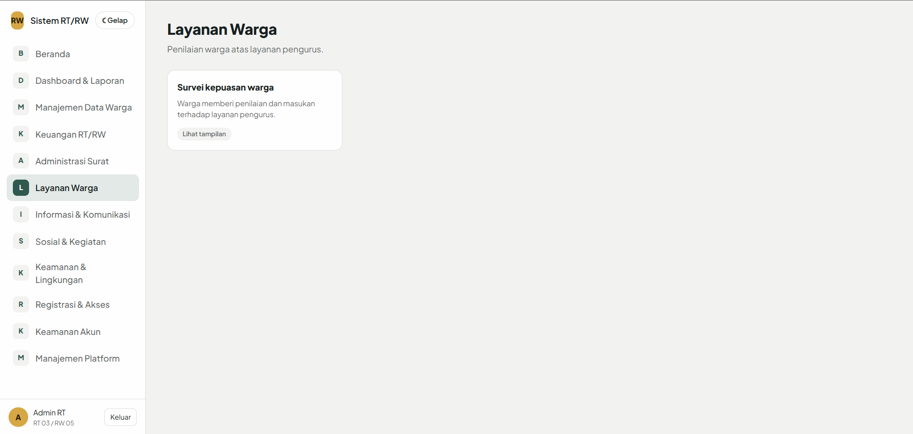 | 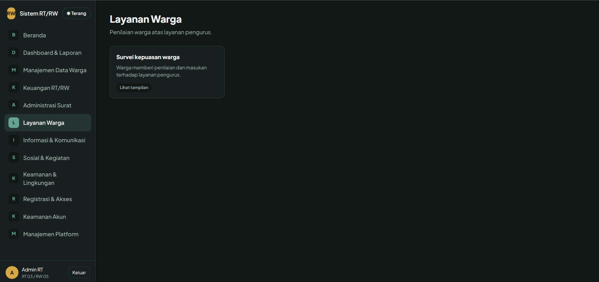 |

**Penjelasan:** Penilaian warga atas layanan pengurus. Modul ini memuat 1 fitur: Survei kepuasan warga.
**Tabel ERD terkait:** `survei`, `jawaban_survei`

#### 4.3.6 Informasi & Komunikasi

| Mode terang | Mode gelap |
|---|---|
| 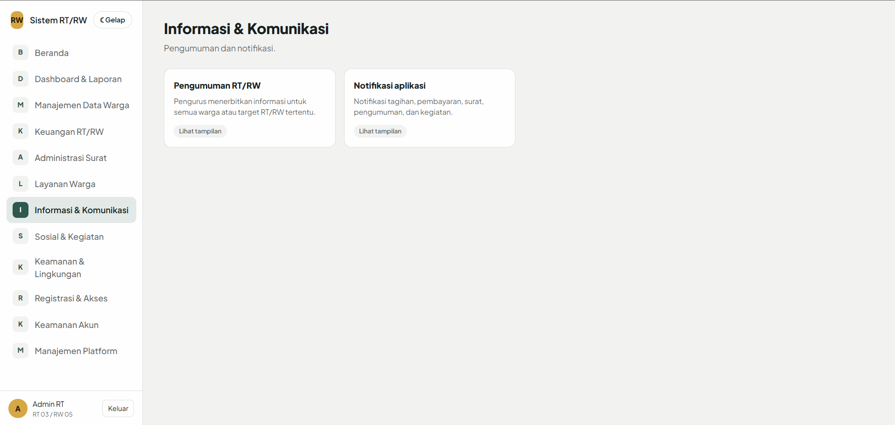 | 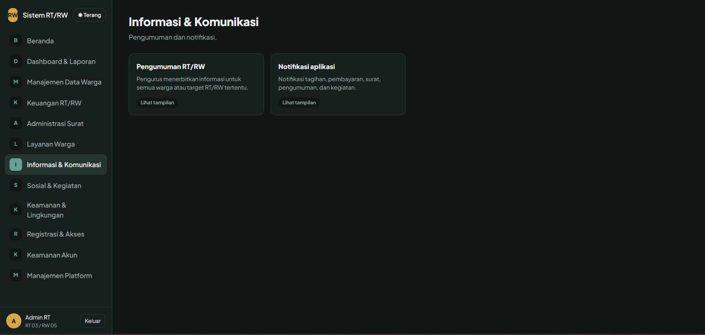 |

**Penjelasan:** Pengumuman dan notifikasi. Modul ini memuat 2 fitur: Pengumuman RT/RW; Notifikasi aplikasi.
**Tabel ERD terkait:** `pengumuman`, `target_pengumuman`, `notifikasi`, `log_notifikasi`

#### 4.3.7 Sosial & Kegiatan

| Mode terang | Mode gelap |
|---|---|
| 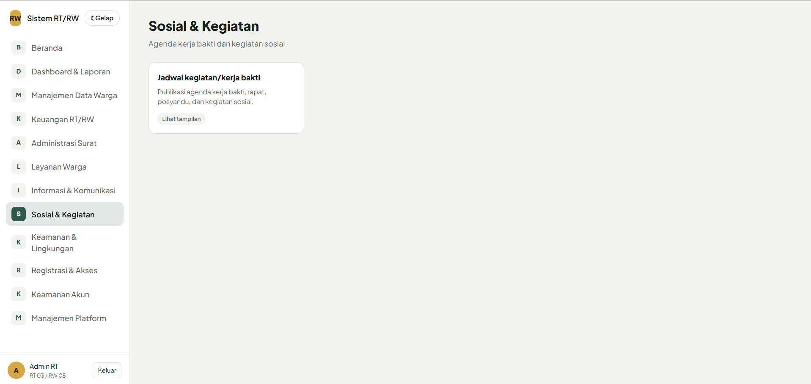 | 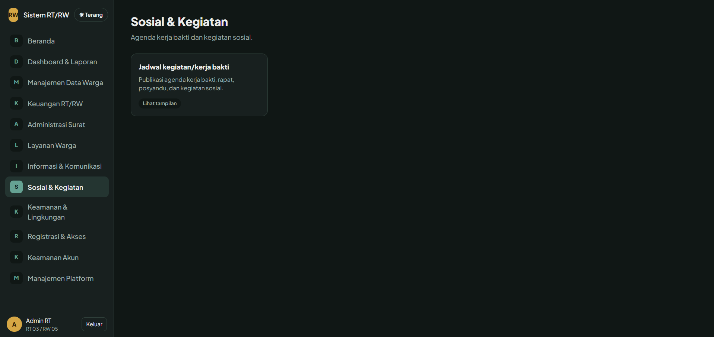 |

**Penjelasan:** Agenda kerja bakti dan kegiatan sosial. Modul ini memuat 1 fitur: Jadwal kegiatan/kerja bakti.
**Tabel ERD terkait:** `kegiatan`, `kehadiran_kegiatan`

#### 4.3.8 Keamanan & Lingkungan

| Mode terang | Mode gelap |
|---|---|
| 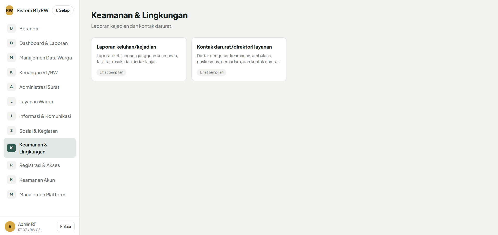 | 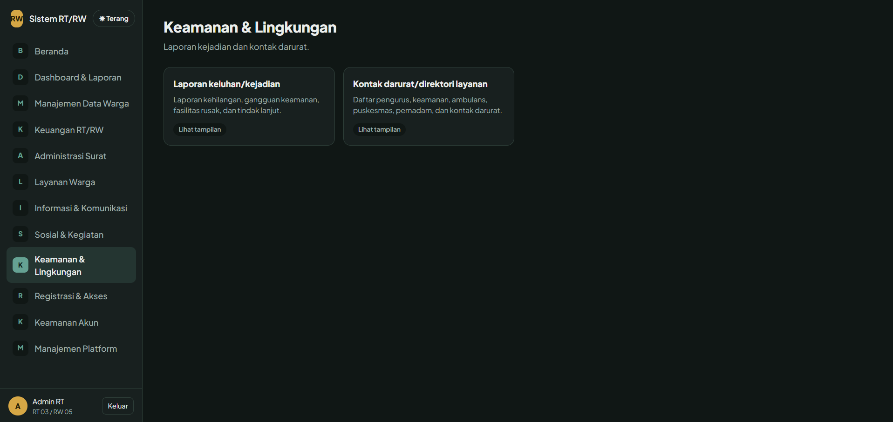 |

**Penjelasan:** Laporan kejadian dan kontak darurat. Modul ini memuat 2 fitur: Laporan keluhan/kejadian; Kontak darurat/direktori layanan.
**Tabel ERD terkait:** `pengaduan`, `tanggapan_pengaduan`, `kontak_darurat`

#### 4.3.9 Registrasi & Akses

| Mode terang | Mode gelap |
|---|---|
| 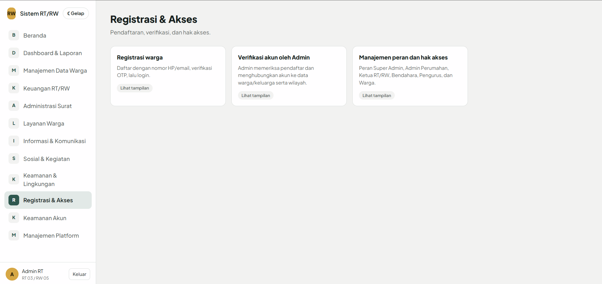 | 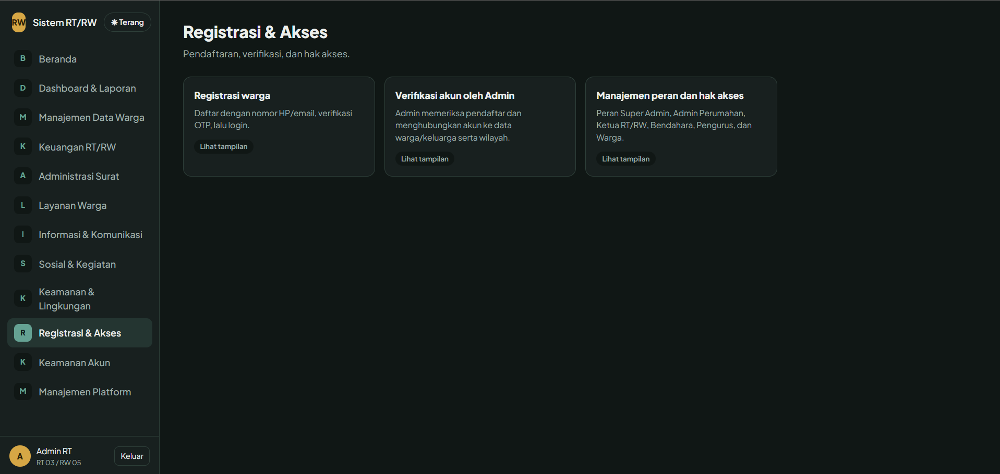 |

**Penjelasan:** Pendaftaran, verifikasi, dan hak akses. Modul ini memuat 3 fitur: Registrasi warga; Verifikasi akun oleh Admin; Manajemen peran dan hak akses.
**Tabel ERD terkait:** `pengguna`, `kode_verifikasi`, `peran`, `izin_akses`, `penugasan_pengguna`

#### 4.3.10 Keamanan Akun

| Mode terang | Mode gelap |
|---|---|
| 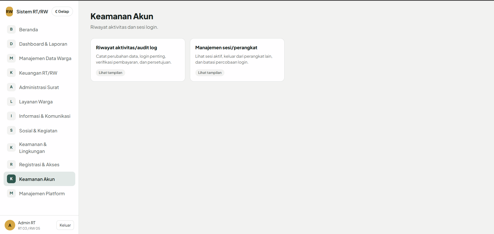 | 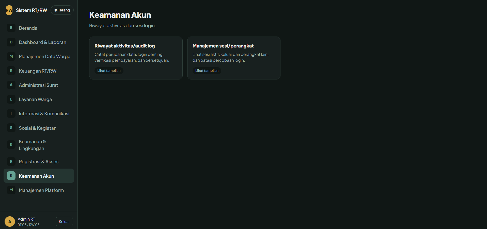 |

**Penjelasan:** Riwayat aktivitas dan sesi login. Modul ini memuat 2 fitur: Riwayat aktivitas/audit log; Manajemen sesi/perangkat.
**Tabel ERD terkait:** `log_audit`, `sesi_pengguna`

#### 4.3.11 Manajemen Platform

| Mode terang | Mode gelap |
|---|---|
| 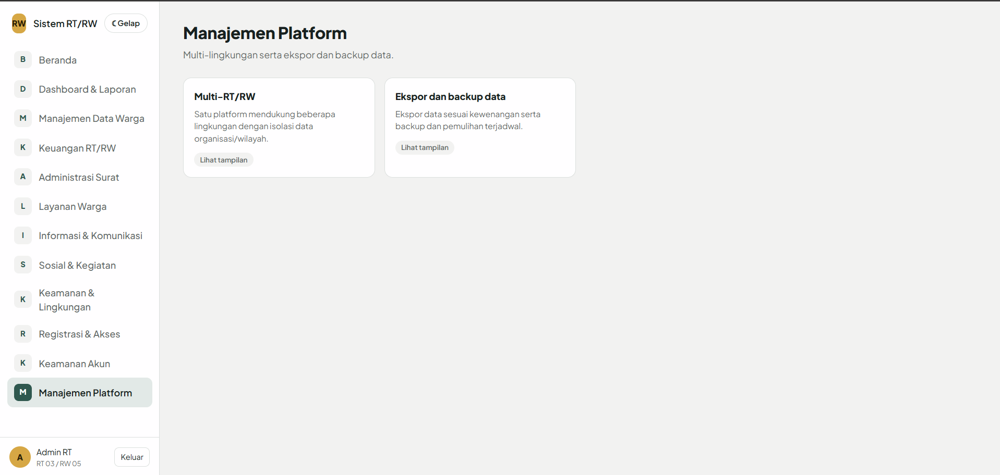 | 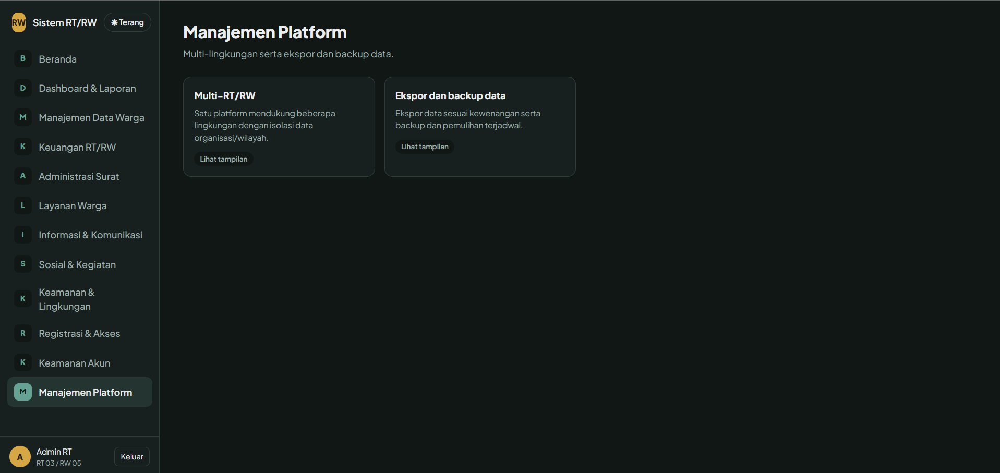 |

**Penjelasan:** Multi-lingkungan serta ekspor dan backup data. Modul ini memuat 2 fitur: Multi-RT/RW; Ekspor dan backup data.
**Tabel ERD terkait:** `organisasi`, `rw`, `rt`, `cadangan_data`, `pengaturan`

---

## 5. Bagian B: Tampilan Fitur di Dalam Menu

Total **26 fitur** dalam 11 modul. Kebanyakan fitur berbentuk **tabel data** dengan kolom pencarian dan tombol aksi. Kolom yang tampil diturunkan dari tabel ERD yang tercantum pada tiap fitur.

### B.1 Dashboard & Laporan

**Dashboard statistik interaktif**

| Mode terang | Mode gelap |
|---|---|
| 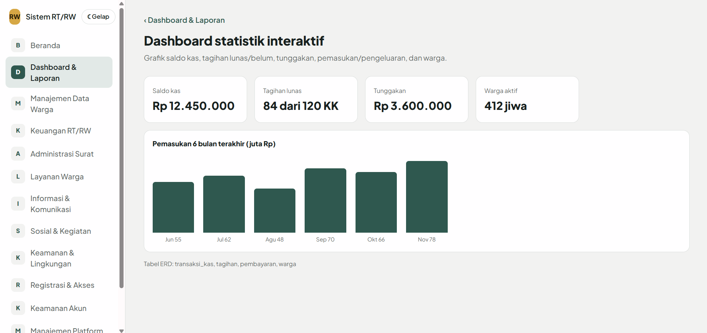 | 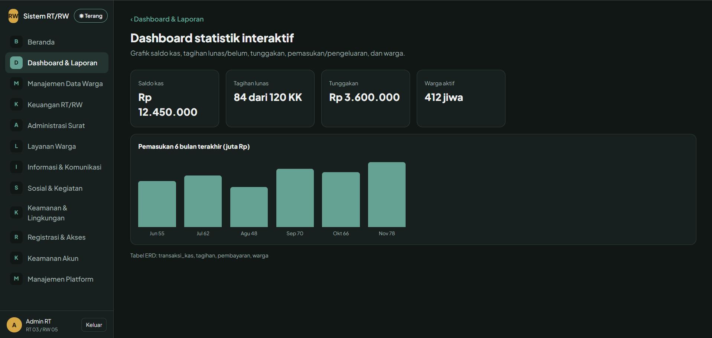 |

Kartu ringkasan (saldo kas, tagihan lunas, tunggakan, warga aktif) dan grafik batang pemasukan 6 bulan terakhir. Membantu pengurus memantau kondisi lingkungan sekilas.
**Tabel ERD terkait:** `transaksi_kas`, `tagihan`, `pembayaran`, `warga`

**Laporan PDF/Excel**

| Mode terang | Mode gelap |
|---|---|
| 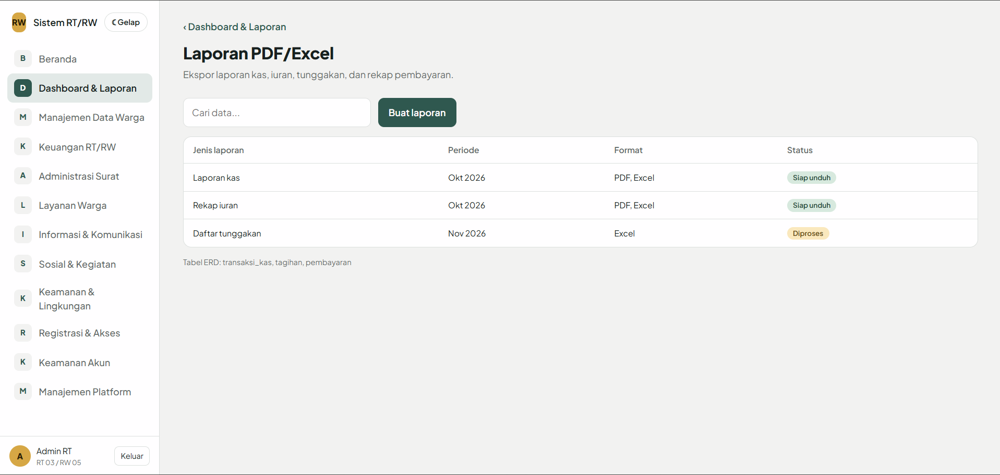 | 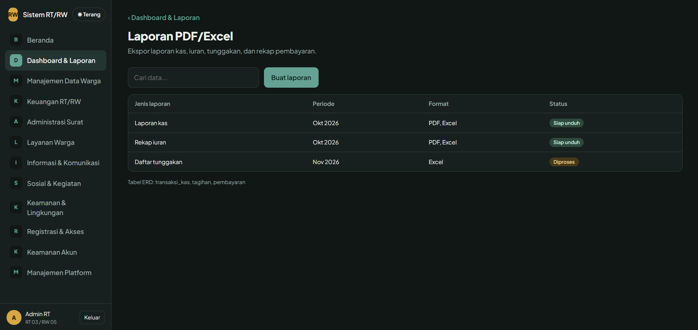 |

Daftar laporan (kas, rekap iuran, daftar tunggakan, rekap pembayaran) beserta periode, format ekspor, dan status ketersediaannya.
**Tabel ERD terkait:** `transaksi_kas`, `tagihan`, `pembayaran`

### B.2 Manajemen Data Warga

**Data warga & kepala keluarga**

| Mode terang | Mode gelap |
|---|---|
| 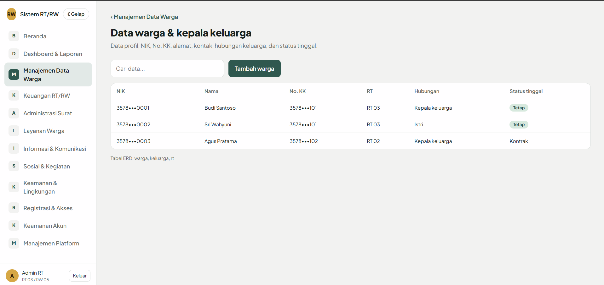 | 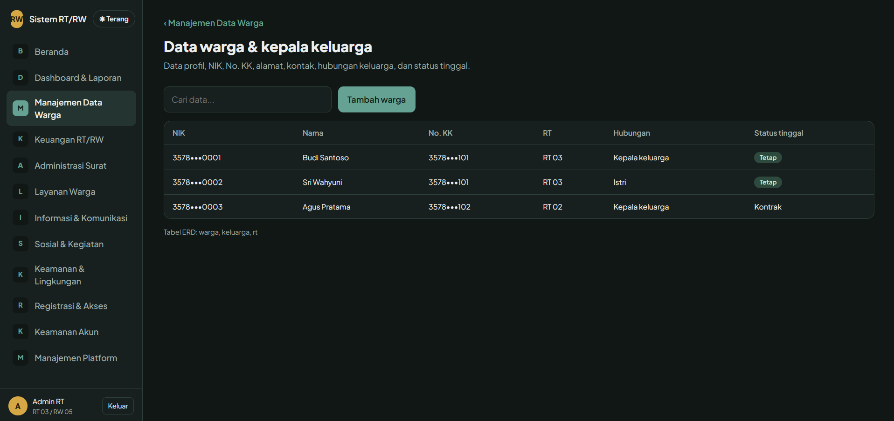 |

Tabel warga berisi NIK, nama, No. KK, RT, hubungan keluarga, dan status tinggal. Tombol *Tambah warga* dipakai untuk input data baru.
**Tabel ERD terkait:** `warga`, `keluarga`, `rt`

**Mutasi dan riwayat warga**

| Mode terang | Mode gelap |
|---|---|
| 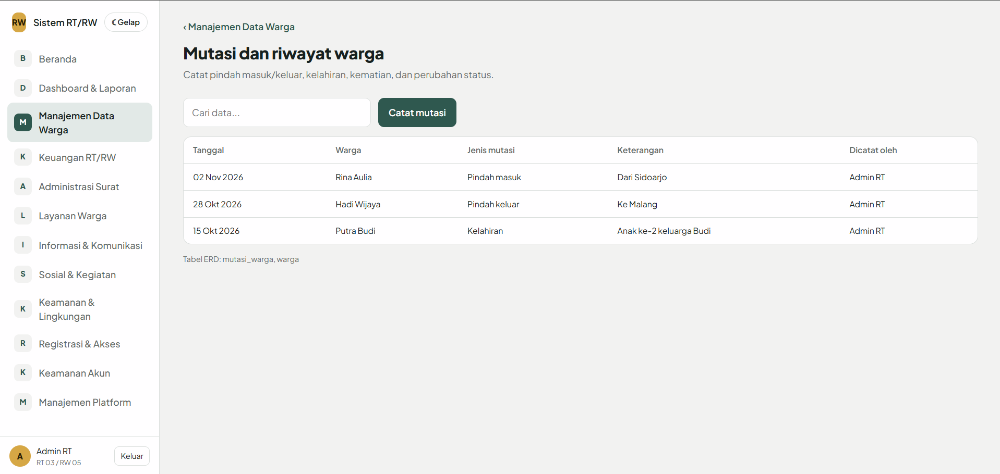 | 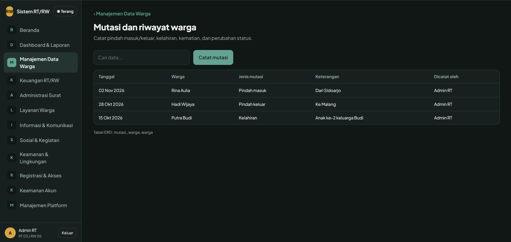 |

Riwayat pindah masuk, pindah keluar, kelahiran, dan kematian, lengkap dengan tanggal, keterangan, dan pencatatnya.
**Tabel ERD terkait:** `mutasi_warga`, `warga`

### B.3 Keuangan RT/RW

**Kategori dan aturan iuran**

| Mode terang | Mode gelap |
|---|---|
| 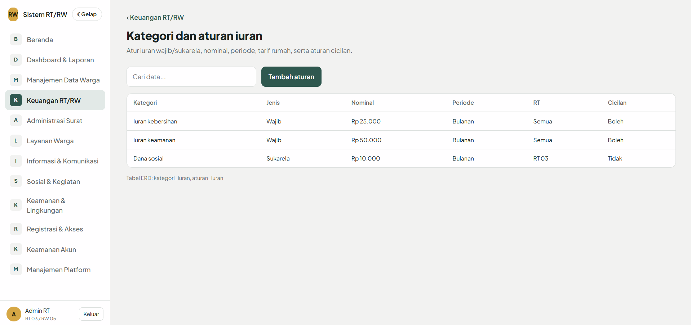 | 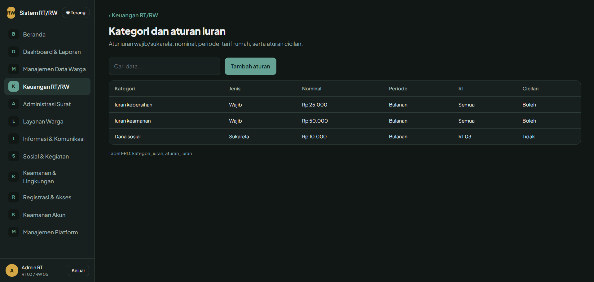 |

Daftar kategori iuran dengan jenis (wajib atau sukarela), nominal, periode, wilayah RT, dan aturan cicilan.
**Tabel ERD terkait:** `kategori_iuran`, `aturan_iuran`

**Tagihan otomatis**

| Mode terang | Mode gelap |
|---|---|
| 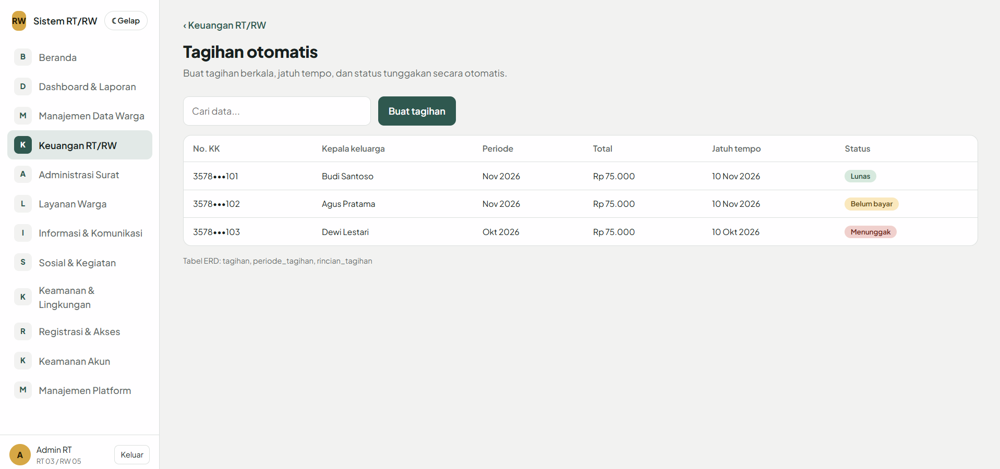 | 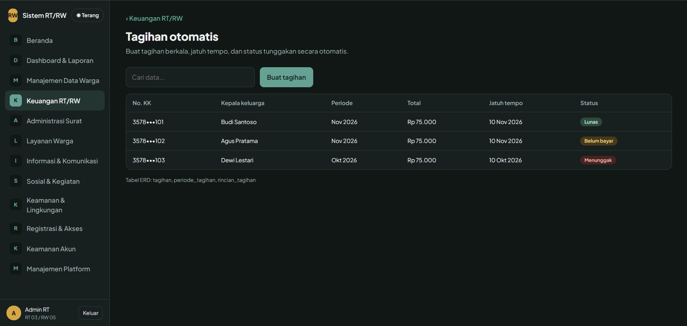 |

Tagihan per keluarga berdasarkan periode, dengan total, jatuh tempo, dan status (lunas, belum bayar, menunggak).
**Tabel ERD terkait:** `tagihan`, `periode_tagihan`, `rincian_tagihan`

**Pembayaran QRIS/transfer/tunai**

| Mode terang | Mode gelap |
|---|---|
| 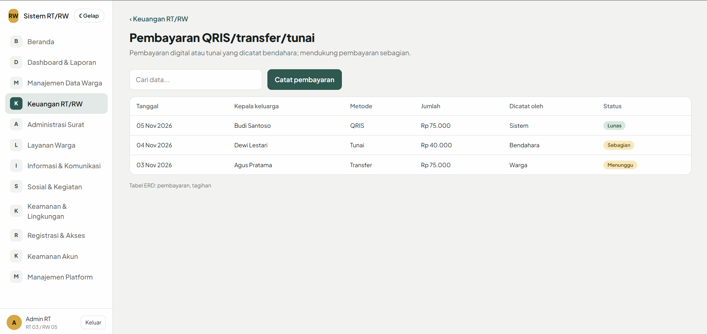 | 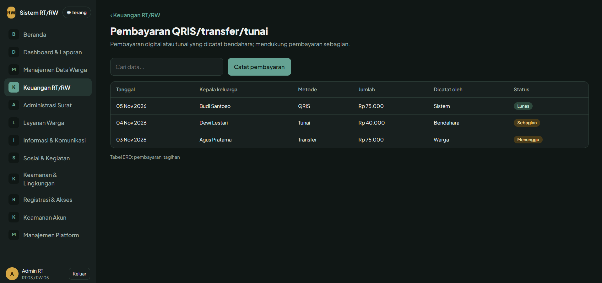 |

Catatan pembayaran dengan metode QRIS, transfer, atau tunai. Pembayaran sebagian (cicilan) ditandai dengan status khusus.
**Tabel ERD terkait:** `pembayaran`, `tagihan`

**Verifikasi bukti pembayaran**

| Mode terang | Mode gelap |
|---|---|
| 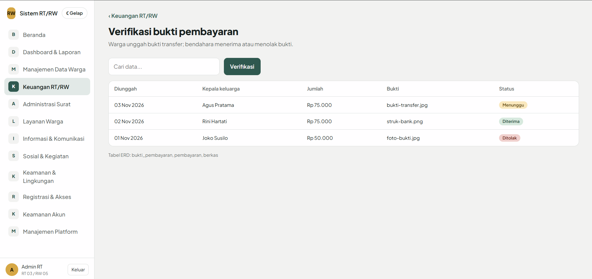 | 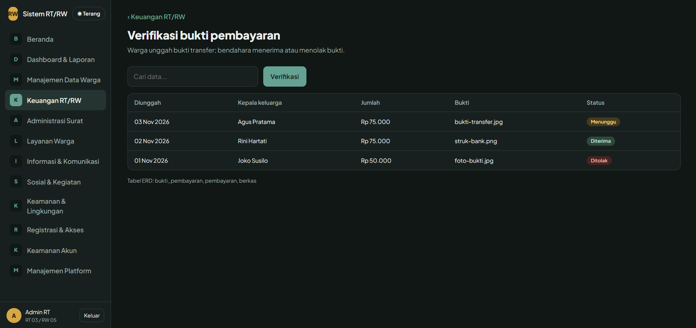 |

Daftar bukti transfer yang diunggah warga. Bendahara menerima atau menolak tiap bukti.
**Tabel ERD terkait:** `bukti_pembayaran`, `pembayaran`, `berkas`

**Riwayat pembayaran & kuitansi**

| Mode terang | Mode gelap |
|---|---|
| 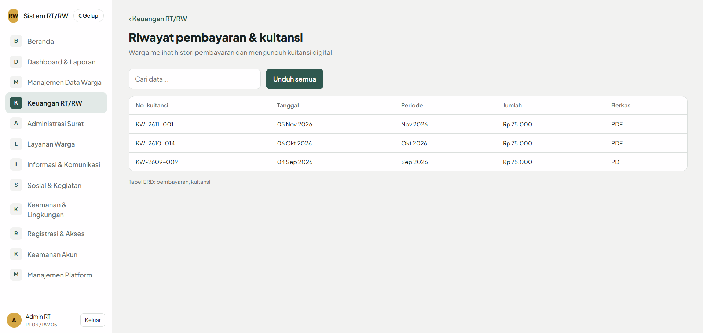 | 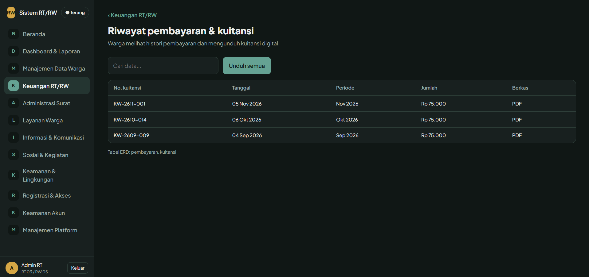 |

Riwayat pembayaran dengan nomor kuitansi dan berkas PDF yang bisa diunduh.
**Tabel ERD terkait:** `pembayaran`, `kuitansi`

**Kas masuk dan pengeluaran**

| Mode terang | Mode gelap |
|---|---|
| 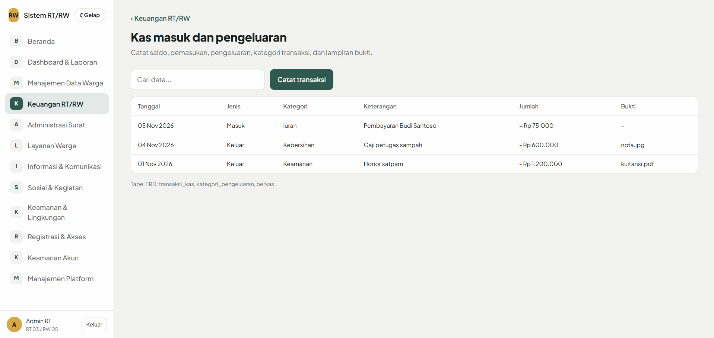 | 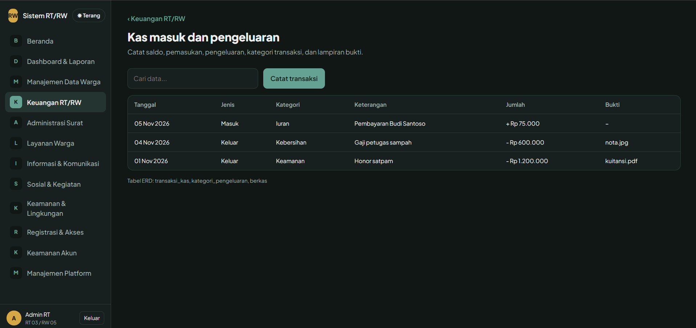 |

Buku kas berisi tanggal, jenis (masuk atau keluar), kategori, keterangan, jumlah, dan bukti lampiran.
**Tabel ERD terkait:** `transaksi_kas`, `kategori_pengeluaran`, `berkas`

**Pengingat iuran/tunggakan**

| Mode terang | Mode gelap |
|---|---|
| 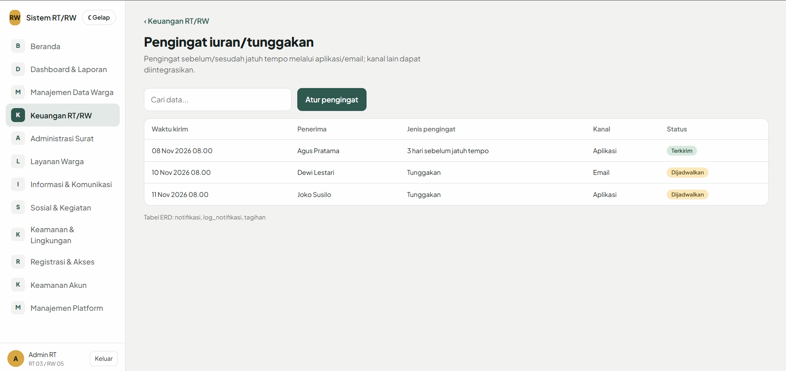 | 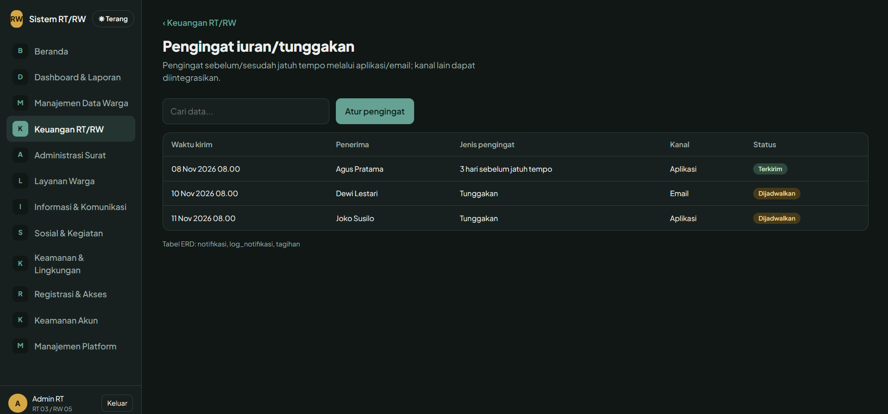 |

Jadwal dan status pengingat yang dikirim sebelum atau sesudah jatuh tempo lewat aplikasi atau email.
**Tabel ERD terkait:** `notifikasi`, `log_notifikasi`, `tagihan`

### B.4 Administrasi Surat

**Pengajuan surat online**

| Mode terang | Mode gelap |
|---|---|
| 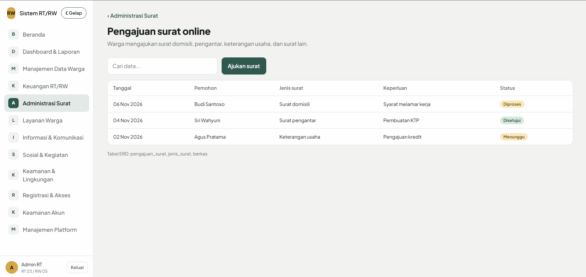 | 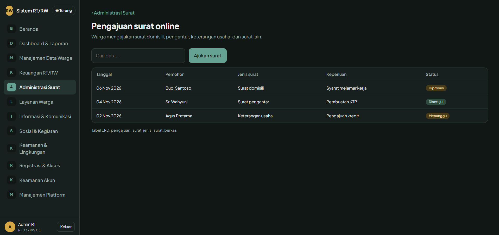 |

Daftar pengajuan surat (domisili, pengantar, keterangan usaha) beserta pemohon, keperluan, dan status proses.
**Tabel ERD terkait:** `pengajuan_surat`, `jenis_surat`, `berkas`

**Verifikasi dan persetujuan surat**

| Mode terang | Mode gelap |
|---|---|
|  |  |

Tampilan pengurus untuk memeriksa pengajuan, mencatat catatan, lalu menyetujui atau menolak.
**Tabel ERD terkait:** `pengajuan_surat`, `persetujuan_surat`

### B.5 Layanan Warga

**Survei kepuasan warga**

| Mode terang | Mode gelap |
|---|---|
|  |  |

Daftar survei dengan periode, jumlah responden, skor rata-rata, dan status.
**Tabel ERD terkait:** `survei`, `jawaban_survei`

### B.6 Informasi & Komunikasi

**Pengumuman RT/RW**

| Mode terang | Mode gelap |
|---|---|
|  |  |

Daftar pengumuman dengan target penerima (semua warga, RW, atau RT tertentu) dan status kirim.
**Tabel ERD terkait:** `pengumuman`, `target_pengumuman`

**Notifikasi aplikasi**

| Mode terang | Mode gelap |
|---|---|
|  |  |

Riwayat notifikasi tagihan, pembayaran, surat, pengumuman, dan kegiatan beserta status terkirim.
**Tabel ERD terkait:** `notifikasi`, `log_notifikasi`

### B.7 Sosial & Kegiatan

**Jadwal kegiatan/kerja bakti**

| Mode terang | Mode gelap |
|---|---|
|  |  |

Agenda kerja bakti, rapat, dan posyandu dengan tanggal, tempat, RT, jumlah hadir, dan status.
**Tabel ERD terkait:** `kegiatan`, `kehadiran_kegiatan`

### B.8 Keamanan & Lingkungan

**Laporan keluhan/kejadian**

| Mode terang | Mode gelap |
|---|---|
|  |  |

Laporan warga (kehilangan, gangguan keamanan, fasilitas rusak) lengkap dengan petugas penanggung jawab dan status tindak lanjut.
**Tabel ERD terkait:** `pengaduan`, `tanggapan_pengaduan`, `berkas`

**Kontak darurat/direktori layanan**

| Mode terang | Mode gelap |
|---|---|
|  |  |

Direktori pengurus, pos keamanan, ambulans, puskesmas, dan pemadam kebakaran.
**Tabel ERD terkait:** `kontak_darurat`

### B.9 Registrasi & Akses

**Registrasi warga**

| Mode terang | Mode gelap |
|---|---|
|  |  |

Form pendaftaran dengan nama, nomor HP atau email, dan kata sandi. Setelah itu warga menerima kode OTP untuk verifikasi.
**Tabel ERD terkait:** `pengguna`, `kode_verifikasi`

**Verifikasi akun oleh Admin**

| Mode terang | Mode gelap |
|---|---|
|  |  |

Admin memeriksa pendaftar, menautkan akun ke data warga atau keluarga, lalu menentukan wilayahnya.
**Tabel ERD terkait:** `pengguna`, `warga`, `keluarga`, `penugasan_pengguna`

**Manajemen peran dan hak akses**

| Mode terang | Mode gelap |
|---|---|
|  |  |

Matriks peran (Super Admin, Admin Perumahan, Ketua RT/RW, Bendahara, Pengurus, Warga) terhadap modul. Tanda `*` berarti akses terbatas pada data milik sendiri atau wilayahnya.
**Tabel ERD terkait:** `peran`, `izin_akses`, `peran_izin_akses`, `penugasan_pengguna`

### B.10 Keamanan Akun

**Riwayat aktivitas/audit log**

| Mode terang | Mode gelap |
|---|---|
|  |  |

Catatan perubahan data, persetujuan, dan verifikasi pembayaran, lengkap dengan waktu, pengguna, objek, dan alamat IP.
**Tabel ERD terkait:** `log_audit`

**Manajemen sesi/perangkat**

| Mode terang | Mode gelap |
|---|---|
|  |  |

Daftar perangkat yang sedang login, dengan tombol keluar dari perangkat lain.
**Tabel ERD terkait:** `sesi_pengguna`

### B.11 Manajemen Platform

**Multi-RT/RW**

| Mode terang | Mode gelap |
|---|---|
|  |  |

Daftar organisasi atau perumahan dalam satu platform, dengan RW, jumlah RT, jumlah warga, dan status. Data tiap organisasi dipisahkan lewat `id_organisasi`.
**Tabel ERD terkait:** `organisasi`, `rw`, `rt`

**Ekspor dan backup data**

| Mode terang | Mode gelap |
|---|---|
|  |  |

Riwayat backup terjadwal dan ekspor data, dengan tombol *Backup sekarang*.
**Tabel ERD terkait:** `cadangan_data`, `pengaturan`

---

## 6. Catatan

1. **Status:** semua gambar adalah **draft desain**, bukan tampilan final. Warna, tata letak, dan istilah masih bisa berubah mengikuti masukan kelompok atau dosen.
2. **Cakupan:** login, beranda, 11 modul, dan 26 fitur, masing-masing dalam mode terang dan gelap.
3. **Data contoh:** nama warga, nominal, dan tanggal hanya dummy. NIK dan nomor telepon sengaja disamarkan.
4. **Kolom tabel:** kolom yang tampil dipilih dari kolom kunci pada ERD dan belum mencakup seluruh kolom di `kamus-data.md`. Kolom lengkap disesuaikan saat implementasi.
5. **Yang belum dirancang:** form tambah atau ubah data, halaman detail, dan alur klik tiap tombol aksi. Desain saat ini berfokus pada halaman daftar atau ringkasan tiap fitur.
6. **Hak akses:** tampilan yang muncul akan berbeda per peran. Misalnya warga hanya melihat tagihan dan surat miliknya, sedangkan bendahara melihat seluruh data keuangan. Draft ini memperlihatkan tampilan seperti yang dilihat admin.
7. **Ukuran gambar:** diambil dalam tampilan desktop. Pada layar kecil, sidebar akan berubah menjadi menu geser.
8. **Acuan:** ERD pada `erd.md` adalah sumber utama. Bila ERD atau daftar fitur berubah, gambar di folder ini perlu diperbarui.

### Rencana pengembangan

| Tahap | Isi | Status |
|---|---|---|
| 1 | Login, beranda, dan 11 modul (terang dan gelap) | Selesai |
| 2 | Tampilan isi 26 fitur (terang dan gelap) | Selesai |
| 3 | Form tambah/ubah, halaman detail, dan alur aksi | Direncanakan |
